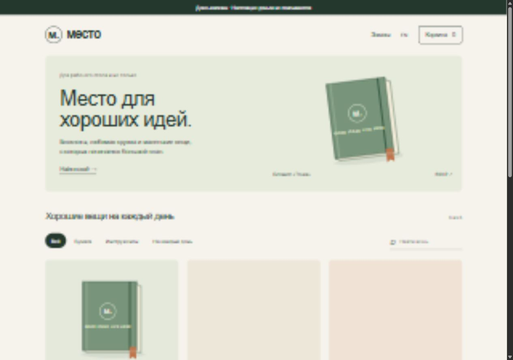

# Multifuncbot

[English](README.md) | Русский

Модульный бот для портфолио: пользователь выбирает сценарий и проходит путь клиента.
Из тех же модулей можно собрать отдельного бота для заказчика. Интерфейс — русский и английский.



## Что реализовано

| Модуль | Для клиента | Для администратора |
| --- | --- | --- |
| `guide` | Гайд Stepwise из трёх шагов, сохранение прогресса, PDF на двух языках | Настраиваемая ссылка для связи |
| `booking` | Услуга, специалист, дата, свободное время, подтверждение и отмена | Подтверждение/отклонение, общий календарь в режиме бизнеса, напоминания |
| `leads` | Задача, имя, контакт, проверка ответов и отправка | Новая → в работе → завершена |
| `shop` | Каталог в чате или Mini App, корзина, оформление и история заказов | Просмотр заказов и уведомления в режиме бизнеса |

В Mini App есть поиск, категории, карточка товара, изменение количества, самовывоз и доставка.
Корзина и заказы общие для чата и Mini App одного пользователя Telegram. Сервер сам считает сумму,
сохраняет состав заказа и защищает оформление от дублей при повторном запросе.

**Настоящие деньги не списываются.** Организации, товары и цены вымышлены. Кнопки успешной,
отклонённой и отменённой оплаты управляют явно обозначенной симуляцией.
ЮKassa, Robokassa и Stars изучены, но не подключены в этой версии.

## Установка и запуск

Нужен Python 3.11 или новее. Команды выполняются из корня проекта.

```powershell
python -m venv .venv
.\.venv\Scripts\python.exe -m pip install -e '.[web,dev]'
Copy-Item .env.example .env
```

Если `.env` уже существует, сохраните его настройки. Создайте **нового** бота через `@BotFather`
и впишите токен в `BOT_TOKEN` внутри локального `.env`. Токен отдельного работающего Stepwise
использовать не нужно. Файл `.env` исключён из Git.

Запуск бота:

```powershell
.\.venv\Scripts\multifuncbot.exe
```

Для Mini App откройте второй терминал:

```powershell
.\.venv\Scripts\multifuncbot-web.exe
```

Откройте [127.0.0.1:8000](http://127.0.0.1:8000). Для отдельного просмотра магазина в браузере
токен бота не требуется. Остановка каждого процесса — Ctrl+C.

На Linux/macOS используйте `python3 -m venv .venv`, `.venv/bin/python`,
`.venv/bin/multifuncbot`, `.venv/bin/multifuncbot-web`; копирование настроек: `cp .env.example .env`.

## Как открыть Mini App из Telegram

1. Разместите веб-приложение по публичному адресу **HTTPS**. Localhost подходит для просмотра в браузере.
2. Укажите `MINI_APP_URL=https://ваш-домен/`. Бот и веб-сервер должны использовать одинаковые
   `BOT_TOKEN` и путь к одной базе `DATABASE_PATH`. Перезапустите оба процесса.
3. В личном чате с ботом выберите «Магазин» → «Открыть Mini App».
4. При желании отдельно настройте основное Mini App/кнопку меню через `@BotFather`.

Авторизация Telegram проверяется сервером. Через час Mini App нужно открыть заново.
Демо в обычном браузере получает отдельную временную сессию и не видит заказы пользователей Telegram.
Передать в запросе чужой ID или свою цену товара нельзя.

Репозиторий не создаёт аккаунт хостинга, публичный HTTPS-адрес или самого бота в BotFather.
Пока адрес Mini App не настроен, доступны каталог и оформление заказа прямо в чате.

## Режимы и основные настройки

- `APP_MODE=showcase` — у каждого посетителя свои демо-данные и свой кабинет администратора.
- `APP_MODE=business` — общие слоты записи, кабинет доступен только ID из `ADMIN_IDS`.
  Перед получением уведомлений администратор должен сам запустить бота в личном чате.
  Оплата и товары остаются демонстрационными.
- `ENABLED_MODULES=guide,booking,leads,shop` — какие сценарии подключены.
- `DEFAULT_MODULE=booking` — сразу открывать запись вместо меню сценариев.
- `DEFAULT_LANGUAGE=ru` — язык до выбора пользователя; доступны `ru` и `en`.
- `TIMEZONE=Europe/Moscow` — часовой пояс студии; время в базе хранится в UTC.
- `DATABASE_PATH=data/multifuncbot.sqlite3` — база данных обоих процессов.
- `MINI_APP_URL` — HTTPS-адрес для кнопки магазина; пустое значение оставляет каталог в чате.
- `ALLOW_BROWSER_DEMO=true` — просмотр в браузере; доступен только в режиме витрины.
- `ADMIN_CONTACT_URL=https://t.me/username` — необязательная ссылка для связи в Stepwise.
- `HOST=127.0.0.1`, `PORT=8000` — адрес веб-сервера.
- `PAYMENT_PROVIDER=demo` — единственный реализованный вариант оплаты.

Все параметры есть в [.env.example](.env.example). Для отдельного бота заказчика см.
[инструкцию по отделению модулей](docs/client-extraction.md).

## Навигация и данные

`/start`, `/menu`, `/help`, `/cancel` открывают меню или выбранный основной сценарий.
`/language` меняет язык, сохраняя текущий шаг/форму. Выход из сценария отменяет незавершённую форму;
прогресс гайда, готовые записи, заявки, корзина и заказы сохраняются.

SQLite сохраняет данные после перезапуска. Отключение модуля не удаляет его таблицы и историю.
Напоминания проверяются раз в минуту для подтверждённых записей, до которых осталось не больше часа;
бот должен работать. После сбоя между отправкой и сохранением отметки напоминание может повториться.
Уведомления администраторам в режиме бизнеса сохраняются в очереди, проверяются раз в 15 секунд
и повторяются при ошибке до пяти попыток. Запускайте один процесс бота.

## Структура

```text
src/multifuncbot/
  app.py                  Общение с Telegram
  web.py                  Отдельный веб-сервер Mini App
  core/                   Настройки, база, маршрутизация, авторизация, уведомления
  modules/
    guide/                Гайд и PDF
    booking/              Расписание и диалог записи
    leads/                Сохранение и обработка заявок
    shop/                 Каталог, заказы, API и интерфейс Mini App
  integrations/payments/   Имитация оплаты
tests/                    Проверки сценариев, изоляции и безопасности
```

Существующий Stepwise остаётся отдельным репозиторием.

## Проверка

```powershell
.\.venv\Scripts\python.exe -m pytest -q
.\.venv\Scripts\ruff.exe check .
node --check src/multifuncbot/modules/shop/static/app.js
```

Node нужен только для необязательной проверки синтаксиса JS. Магазин работает без сборщика.
Проверенные версии зависимостей сохранены в `requirements-dev.lock`: для их воспроизведения
установите `-r requirements-dev.lock`, затем сам проект командой `pip install --no-deps -e .`.
GitHub Actions проверяет Python 3.11 и 3.13. Тесты работают с отдельными временными базами
и вымышленными токенами Telegram.

[Архитектура](docs/architecture.md) · [Исследование аналогов](docs/research.md) ·
[Результаты и границы проверок](docs/verification.md) · [Дальнейшие этапы](docs/roadmap.md)
